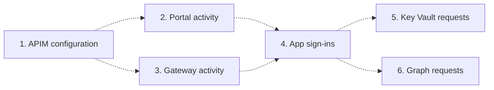

On 20 November, Norway's National Security Authority (NSM) [linked attacks on Norwegian companies, including Equinor and Skagerak Energi, to a vulnerability in Azure API Management (APIM)](https://nsm.no/aktuelt/nsm-deler-tiltak-mot-sarbarhet-i-azure-api-management). NSM says an unknown actor sought **access tokens, secrets and named values**. It believes the vulnerability is closed but advises customers to check their runtime version. The extent of exploitation is not publicly known. [Equinor reported an attack](https://www.equinor.com/news/20261711-equinor-detected-cyber-attack) on 17 November and later said it found no sign of data theft or alteration; [Skagerak Energi reported a possible attempted attack](https://www.skagerakenergi.no/presse/pressemeldinger/skagerak-energi-utsatt-for-forsok-pa-cyberangrep) on 18 November, with no operational impact.

If you run APIM, patching isn't the end of it. Assume what was stored in APIM is out, rotate it, and check your logs for what happened next.

This post is my understanding of the case based on public sources; I'll update it as more information becomes available.

## The risk in plain terms ⚠️

APIM sits in front of your APIs and holds the keys to reach them. Depending on your setup, that includes:

- **Named values**: plain text, secrets, or Key Vault references used by policies.
- **Backend credentials**: client secrets, certificates and API keys for the services behind APIM.
- **Subscription keys** and the identity-provider settings for the developer portal.

If someone obtains a credential from that configuration, they may be able to use it directly against the service it protects, outside APIM. What they can reach depends on the credential's permissions and whether it is still valid.

[Microsoft documents](https://learn.microsoft.com/en-us/azure/api-management/api-management-howto-properties) that policy editors can read named values and request tracing can reveal Key Vault-backed values. Key Vault references reduce direct secret storage in APIM, but don't protect a value from someone who can expose it through policy editing or tracing.

### The old Management API: retired, but check it's off

Each APIM instance has its own management endpoint, `<instance>.management.azure-api.net`, called the [direct Management API](https://learn.microsoft.com/en-us/rest/api/apimanagement/apimanagementrest/api-management-rest). It came before Azure Resource Manager (ARM) as the way to manage APIM. It doesn't use Entra ID. It authenticates with a `SharedAccessSignature` token in the `Authorization` header, signed with the instance's tenant access key.

Microsoft [retired it in March 2025](https://learn.microsoft.com/en-us/azure/api-management/breaking-changes/direct-management-api-retirement-march-2025), which means unsupported, not necessarily removed. In the portal, set **Management API → Enable Management REST API** to **No** on every instance. The endpoint bypasses Entra ID and Azure RBAC, and its calls aren't recorded in the ARM Activity log.

## What to do now 🛠️

1. **Update and assume exposure.** Check the runtime against the [NSM advisory](https://nsm.no/aktuelt/nsm-deler-tiltak-mot-sarbarhet-i-azure-api-management), and treat secrets, tokens and named values in APIM as exposed.
2. **Rotate** them: backend credentials, app registration secrets, subscription keys, the Key Vault secrets APIM references and the tenant access keys.
3. **Clean up APIM users.** Remove or block accounts you don't need, and check who can edit policies or use tracing.
4. **Turn off the old Management API.** Set **Enable Management REST API** to **No** on every instance.
5. **Shut the old developer portal.** If you don't need it, unpublish it and disable sign-up. If you do, restrict sign-up, remove identity providers you no longer use and require approval on every product.
6. **Map** which data and systems sit behind each APIM instance.
7. **Hunt** in the logs below.

### Why the old developer portal matters 🧟

An old portal may still allow sign-up, use unnecessary identity providers, or expose products without approval. Each sign-up creates an APIM user; combined with stale credentials and missing diagnostics, that can become an unowned access path. NSM has not said a portal was involved in this incident, but research by [Praetorian](https://www.praetorian.com/blog/azure-apim-signup-bypass/) and [Bountyy](https://github.com/bountyyfi/Azure-APIM-Cross-Tenant-Signup-Bypass/security/advisories/GHSA-vcwf-73jp-r7mv) shows how sign-up can be abused under specific identity-provider and product settings.

## Log sources you must have 📋

Before hunting, confirm each source is enabled, when collection started and how long logs are kept.

| Log source | Table | How to get it | What it answers |
| --- | --- | --- | --- |
| Azure Activity log | `AzureActivity` | Subscription diagnostic setting to Log Analytics | Matching ARM management actions, such as secret-list requests and configuration changes |
| APIM gateway logs | `ApiManagementGatewayLogs` or `AzureDiagnostics` | APIM diagnostic setting, **Gateway logs**; destination table mode determines the table | Which subscription identifiers called which APIs, from where, and whether tracing was requested or allowed |
| APIM developer portal logs | `APIMDevPortalAuditDiagnosticLog` | APIM diagnostic setting, **Developer portal usage** | Whether a "dead" portal is in use. Has no source IP column |
| Entra service principal sign-ins | `AADServicePrincipalSignInLogs` | Entra ID diagnostic setting, service principal sign-ins | Whether app credentials were used, from where and for which resource |
| Key Vault audit logs | `AZKVAuditLogs` or `AzureDiagnostics` | Key Vault diagnostic setting, **AuditEvent**. The destination table option decides where it lands | Who read or listed the secrets APIM references |
| Microsoft Graph activity logs | `MicrosoftGraphActivityLogs` | Entra ID diagnostic setting. Requires Entra ID P1 or P2 | What an app did in Graph after signing in |

Key Vault logs land in `AZKVAuditLogs` with **Resource specific** mode or `AzureDiagnostics` with **Azure diagnostics**. Check each vault's destination and [table retention](https://learn.microsoft.com/en-us/azure/azure-monitor/logs/data-retention-configure); an empty result from a newly enabled table tells you little.

## Hunting step by step 🧭

The steps move from **APIM configuration → portal and gateway → identity → Key Vault and Graph**. **This is a hunting map, not a confirmed attack chain.** Dotted arrows show investigation pivots, not required attack steps.



Direct Management API calls don't appear in the Activity log, so these hunts focus on configuration, portal and gateway activity, and where credentials are used next.

**Before you start, collect:**

- The resource IDs of your APIM instances.
- The principal (object) ID of each APIM managed identity.
- The application (client) IDs of apps whose secrets are stored in APIM. Look in named values, backends and identity-provider settings.
- The Key Vaults that APIM named values point to.

The queries use 30-day and 7-day windows. Widen them if your retention allows and the portal hasn't been reviewed for a while.

### Step 1: Who touched APIM configuration?

Start in the control plane. This query finds actions that reveal secrets or change what APIM trusts: listing named-value and subscription secrets, writing policies, and adding users, identity providers or portal settings.

```kusto
let timeframe = 30d;
AzureActivity
| where TimeGenerated > ago(timeframe)
| where ResourceProviderValue =~ "MICROSOFT.APIMANAGEMENT"
| extend Op = tolower(OperationNameValue)
| where Op contains "/namedvalues/listvalue/action"
    or Op contains "/subscriptions/listsecrets/action"
    or Op contains "/tenant/listsecrets/action"
    or Op contains "/identityproviders/listsecrets/action"
    or Op contains "/policies/write"
    or Op contains "/namedvalues/write"
    or Op contains "/identityproviders/write"
    or Op contains "/users/write"
    or Op contains "/portalsettings/write"
    or Op contains "/portalrevisions/write"
| summarize Count = count(),
            FirstSeen = min(TimeGenerated),
            LastSeen = max(TimeGenerated),
            Operations = make_set(Op, 20),
            Statuses = make_set(ActivityStatusValue, 5),
            SourceIPs = make_set(CallerIpAddress, 20)
    by Caller, _ResourceId
| order by FirstSeen asc
```

**What it tells you:** which users, apps or managed identities made these matching control-plane requests, and from which addresses. Check each caller against your administrators and pipelines. A `listValue` call from someone with no reason to touch APIM, or a policy change nobody can explain, is a lead to investigate.

**Limitation:** the Activity log records ARM write and action operations, not ordinary reads. It won't show someone reading a non-secret named value or a policy. It does not capture calls to the direct Management API.

### Step 2: Is the "unused" developer portal actually in use?

If you thought the portal was dead, any activity is a finding. This query summarises portal activity per user per day and flags sign-ups and account changes.

```kusto
let timeframe = 30d;
APIMDevPortalAuditDiagnosticLog
| where TimeGenerated > ago(timeframe)
| extend Path = tolower(tostring(split(RequestPath, "?")[0]))
| extend IsAccountChange = (Path contains "signup"
                            or Path contains "/users/"
                            or Path contains "identities"
                            or Path contains "confirm")
                           and RequestMethod in~ ("POST", "PUT", "PATCH")
| summarize Requests = count(),
            AccountChanges = countif(IsAccountChange),
            Paths = make_set(Path, 25),
            ResponseCodes = make_set(ResponseCode, 10),
            UserAgents = make_set(UserAgent, 5)
    by ServiceName, HashedUserId, Day = bin(TimeGenerated, 1d)
| order by Day asc, AccountChanges desc
```

**What it tells you:** which portal requests match account-related paths. These requests do not prove an account was created; check their response codes and correlate with APIM user or subscription records. The table holds a hashed user ID and no source-IP column.

### Step 3: Newly observed subscription identifiers and tracing on the gateway

Anyone who gets a subscription key, through the portal or from configuration, may use it to call your APIs. This query finds subscription identifiers not seen in the earlier baseline period, scoped to the same APIM resource, and requests for tracing. A subscription identifier is not the secret key: rotating a key may not change the identifier.

```kusto
let baseline = 30d;
let recent = 7d;
let KnownSubscriptions = ApiManagementGatewayLogs
    | where TimeGenerated between (ago(baseline) .. ago(recent))
    | where isnotempty(ApimSubscriptionId)
    | distinct _ResourceId, ApimSubscriptionId
    | extend SeenBefore = true;
ApiManagementGatewayLogs
| where TimeGenerated > ago(recent)
| join kind=leftouter KnownSubscriptions on _ResourceId, ApimSubscriptionId
| extend NewSubscriptionId = isnotempty(ApimSubscriptionId) and coalesce(SeenBefore, false) == false
| where NewSubscriptionId or IsTraceRequested == true
| summarize Requests = count(),
            FirstSeen = min(TimeGenerated),
            LastSeen = max(TimeGenerated),
            Apis = make_set(ApiId, 20),
            Products = make_set(ProductId, 10),
            CallerIPs = make_set(CallerIpAddress, 20),
            TraceRequests = countif(IsTraceRequested == true),
            AllowedTraceRequests = countif(IsTraceAllowed == true),
            ResponseCodes = make_set(ResponseCode, 10)
    by _ResourceId, ApimSubscriptionId, UserId, NewSubscriptionId
| order by FirstSeen asc
```

**What it tells you:** which subscription identifiers are new to the observed baseline and which requests asked for tracing. Compare `TraceRequests` with `AllowedTraceRequests`: a request is not proof tracing was allowed. A new identifier is a lead, not proof a new key was issued or misused. Tracing can expose sensitive values, so investigate unexpected allowed traces.

This query assumes the resource-specific `ApiManagementGatewayLogs` table. If your diagnostic setting sends gateway logs to `AzureDiagnostics`, inspect the schema first and adapt the table and column names; the columns vary by destination mode.

### Step 4: Are APIM-linked app credentials being used from new places?

If app secrets stored in APIM were stolen, the attacker signs in **as the app**. This query compares the last 7 days with the period before and shows sign-ins from addresses the app hasn't used before.

```kusto
let baseline = 30d;
let recent = 7d;
let ApimAppIds = dynamic([]); // application (client) IDs collected before Step 1
let Known = AADServicePrincipalSignInLogs
    | where TimeGenerated between (ago(baseline) .. ago(recent))
    | where AppId in (ApimAppIds)
    | distinct AppId, IPAddress;
AADServicePrincipalSignInLogs
| where TimeGenerated > ago(recent)
| where AppId in (ApimAppIds)
| join kind=leftanti Known on AppId, IPAddress
| summarize Attempts = count(),
            Successes = countif(ResultType in~ ("0", "Success")),
            Resources = make_set(ResourceDisplayName, 20),
            ResultTypes = make_set(ResultType, 10),
            CredentialKeys = make_set(ServicePrincipalCredentialKeyId, 5),
            FirstSeen = min(TimeGenerated)
    by AppId, ServicePrincipalName, IPAddress, Location
| order by Successes desc, FirstSeen asc
```

**What it tells you:** whether an APIM-linked app signed in from an IP not seen during the baseline, and to which resources. Watch for one app requesting tokens for many resources in a short period. Failed attempts are worth investigating, but a failed sign-in does not prove the requester possessed a previously valid secret.

An empty `ApimAppIds` list returns nothing on purpose. Fill it with the application (client) IDs you collected, and use the same populated list in Step 6.

Microsoft's table reference describes `ResultType` values as `Success` or `Failure`, while a Microsoft sample query uses `0` for success. This query counts either documented representation; inspect the values in your workspace before relying on the count.

### Step 5: Who is going after the secrets APIM references?

Key Vault-backed named values point to specific vaults and secrets. This query groups requests by caller and 15-minute window, keeping each operation, target URI and HTTP status separate. A successful `SecretGet` stays tied to its target instead of being mixed with denied requests or list operations. A successful list returns secret identifiers and metadata, not secret values. Don't assume the APIM managed identity is the only legitimate reader; review callers against your own access design.

```kusto
let timeframe = 30d;
let ApimIdentities = dynamic([]); // principal IDs of APIM managed identities
let ApimVaults = dynamic([]);     // lower-case Key Vault resource IDs used by APIM; empty = all vaults
AZKVAuditLogs
| where TimeGenerated > ago(timeframe)
| where OperationName in ("SecretGet", "SecretList", "SecretListVersions")
| where array_length(ApimVaults) == 0 or tolower(_ResourceId) in (ApimVaults)
| extend CallerOid = tolower(case(
             isnotempty(tostring(Identity.claim.oid)), tostring(Identity.claim.oid),
             tostring(Identity.claim["http://schemas.microsoft.com/identity/claims/objectidentifier"]))),
         CallerAppId = tostring(Identity.claim.appid)
| extend Result = case(
    HttpStatusCode between (200 .. 299), "Allowed",
    HttpStatusCode == 401, "Unauthenticated",
    HttpStatusCode == 403, "Forbidden",
    "Other")
| summarize Requests = count(),
            SecretGetAllowed = countif(OperationName == "SecretGet" and HttpStatusCode between (200 .. 299)),
            ListAllowed = countif(OperationName in ("SecretList", "SecretListVersions") and HttpStatusCode between (200 .. 299)),
            FailedRequests = countif(HttpStatusCode !between (200 .. 299)),
            Clients = make_set(ClientInfo, 5),
            FirstSeen = min(TimeGenerated),
            LastSeen = max(TimeGenerated)
    by Window = bin(TimeGenerated, 15m), _ResourceId, OperationName, RequestUri,
       HttpStatusCode, Result, CallerIpAddress, CallerOid, CallerAppId
| extend IsApimManagedIdentity = CallerOid in~ (ApimIdentities)
| order by Requests desc, FirstSeen asc
```

**Using `AzureDiagnostics`?** Its columns vary by workspace. First inspect the schema with `AzureDiagnostics | getschema`, then sample Key Vault audit rows to identify the operation and identity fields used in your workspace:

```kusto
let timeframe = 30d;
AzureDiagnostics
| where TimeGenerated > ago(timeframe)
| where ResourceProvider =~ "MICROSOFT.KEYVAULT" and Category == "AuditEvent"
| top 50 by TimeGenerated desc
```

This is a schema-discovery sample, not an equivalent hunt. Use those rows to map the operation, status, request URI, caller and identity fields, then adapt the query above while keeping operation, target URI and HTTP status separate. Identity claims may be expanded into columns or stored in `AdditionalFields`; don't assume a particular generated column name.

**What it tells you:**

- **Successful `SecretGet` by an unexpected caller** means the secret value was returned. Use that row's `RequestUri` to identify the target, then assess and rotate the secret. If the URI is missing, inspect the original event before naming a specific secret.
- **Successful list operations** expose secret identifiers and metadata, not the values.
- **Denied or unauthenticated requests** show attempts, not successful access. A 15-minute cluster across relevant vaults is a lead to investigate.
- **Clients** shows the recorded client information. Compare it with what your legitimate callers use.

A 403 means that request was denied. It doesn't rule out another access path, such as APIM policy editing or tracing.

### Step 6: What did the app do in Microsoft Graph?

If an APIM-linked app has Graph permissions, check what it called. This query summarises Graph requests per app and endpoint for the last 7 days.

Replace `[]` with the populated app-ID list from Step 4. Each query runs independently; this placeholder does not inherit the earlier list.

```kusto
let recent = 7d;
let ApimAppIds = dynamic([]); // same list as Step 4
MicrosoftGraphActivityLogs
| where TimeGenerated > ago(recent)
| where AppId in (ApimAppIds)
| extend Endpoint = tostring(parse_url(RequestUri).Path)
| summarize Requests = count(),
            Methods = make_set(RequestMethod, 5),
            StatusCodes = make_set(ResponseStatusCode, 10),
            IPs = make_set(IPAddress, 20),
            FirstSeen = min(TimeGenerated)
    by AppId, ServicePrincipalId, Endpoint
| order by Requests desc
```

**What it tells you:** whether the app did anything outside its normal job, such as listing users, groups, apps or service principals, reading mail, or adding credentials to other apps. Compare the IPs with the new addresses from Step 4.

## Reading the results 🧠

- **No match isn't proof of safety.** Check that each log was enabled and kept for the whole period.
- **A match isn't proof of compromise.** Newly observed subscription identifiers, IPs and callers are leads. Confirm them with the owners.
- **Follow the chain.** A suspicious configuration action, portal request, new subscription identifier, sign-in and Key Vault request at matching times form a stronger lead than any one result alone.
- **Lab checks are not detection validation.** My lab has no APIM instance. Steps 4 and 6 initially used empty `ApimAppIds` lists, so their empty results were expected. Separate checks used sample apps, not confirmed APIM-linked apps. Check table availability, column names, operation values and representative results in your workspace before using these as detections.

## Wrap-up ✅

Update APIM, rotate its credentials, close unused access paths and hunt the logs. A runtime fix can't undo what may already have been exposed.

## References

- [NSM: Measures against the vulnerability in Azure API Management (Norwegian)](https://nsm.no/aktuelt/nsm-deler-tiltak-mot-sarbarhet-i-azure-api-management)
- [Equinor: Equinor detected cyber attack](https://www.equinor.com/news/20261711-equinor-detected-cyber-attack)
- [Skagerak Energi: Possible attempted cyberattack (Norwegian)](https://www.skagerakenergi.no/presse/pressemeldinger/skagerak-energi-utsatt-for-forsok-pa-cyberangrep)
- [The Record: Equinor cyberattack coverage](https://therecord.media/norway-equinor-cyberattack-energy)
- [Microsoft Threat Intelligence: Threat actors use agentic AI tooling to find and abuse exposed secrets](https://www.microsoft.com/en-us/security/blog/2026/11/05/threat-actors-use-agentic-ai-tooling-to-find-and-abuse-exposed-secrets/)
- [Todyl: Stolen app credentials, real access](https://www.todyl.com/blog/stolen-app-credentials-real-access-an-actor-is-signing-into-entra-id-and-azure-devops-as-your-workloads)
- [Praetorian: Azure APIM sign-up bypass](https://www.praetorian.com/blog/azure-apim-signup-bypass/)
- [Bountyy: APIM cross-tenant sign-up bypass advisory](https://github.com/bountyyfi/Azure-APIM-Cross-Tenant-Signup-Bypass/security/advisories/GHSA-vcwf-73jp-r7mv)
- [Microsoft Learn: Use named values in Azure API Management policies](https://learn.microsoft.com/en-us/azure/api-management/api-management-howto-properties)
- [Microsoft Learn: Direct management API retirement](https://learn.microsoft.com/en-us/azure/api-management/breaking-changes/direct-management-api-retirement-march-2025)
- [Microsoft Learn: Direct management API](https://learn.microsoft.com/en-us/rest/api/apimanagement/apimanagementrest/api-management-rest)
- [Microsoft Learn: Azure Activity log](https://learn.microsoft.com/en-us/azure/azure-monitor/fundamentals/activity-log)
- [Microsoft Learn: Monitor API Management](https://learn.microsoft.com/en-us/azure/api-management/monitor-api-management)
- [Microsoft Learn: APIMDevPortalAuditDiagnosticLog table](https://learn.microsoft.com/en-us/azure/azure-monitor/reference/tables/apimdevportalauditdiagnosticlog)
- [Microsoft Learn: API Management gateway logs table](https://learn.microsoft.com/en-us/azure/azure-monitor/reference/tables/apimanagementgatewaylogs)
- [Microsoft Learn: Azure Key Vault logging](https://learn.microsoft.com/en-us/azure/key-vault/general/logging)
- [Microsoft Learn: AADServicePrincipalSignInLogs table](https://learn.microsoft.com/en-us/azure/azure-monitor/reference/tables/aadserviceprincipalsigninlogs)
- [Microsoft Learn: Kusto string operators](https://learn.microsoft.com/en-us/kusto/query/datatypes-string-operators?view=microsoft-fabric)
- [Microsoft Learn: AZKVAuditLogs table](https://learn.microsoft.com/en-us/azure/azure-monitor/reference/tables/azkvauditlogs)
- [Microsoft Learn: Azure Key Vault monitoring data reference](https://learn.microsoft.com/en-us/azure/key-vault/general/monitor-key-vault-reference)
- [Microsoft Learn: Microsoft Graph activity logs](https://learn.microsoft.com/en-us/graph/microsoft-graph-activity-logs-overview)
- [Microsoft Learn: Configure data retention in Log Analytics](https://learn.microsoft.com/en-us/azure/azure-monitor/logs/data-retention-configure)

*This post was co-written with the assistance of AI.*
